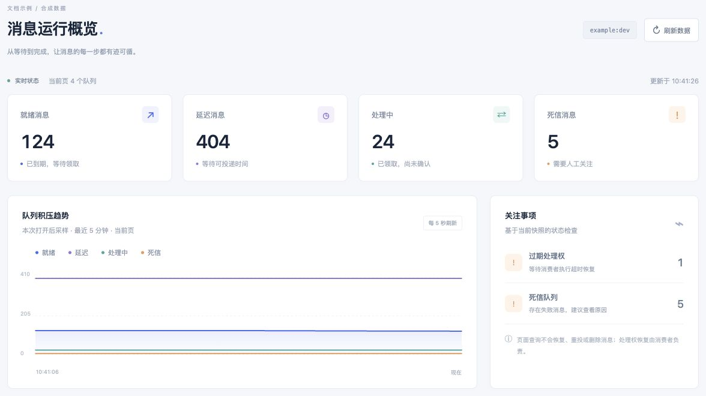
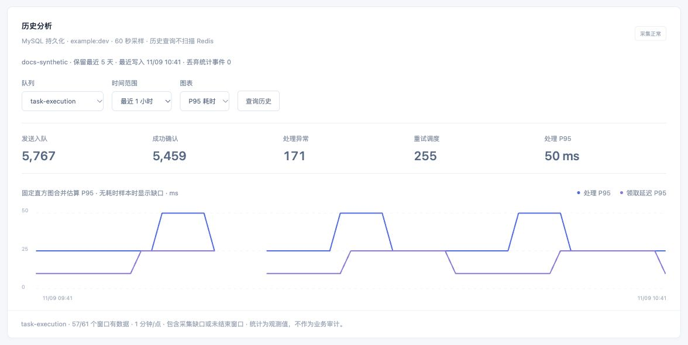
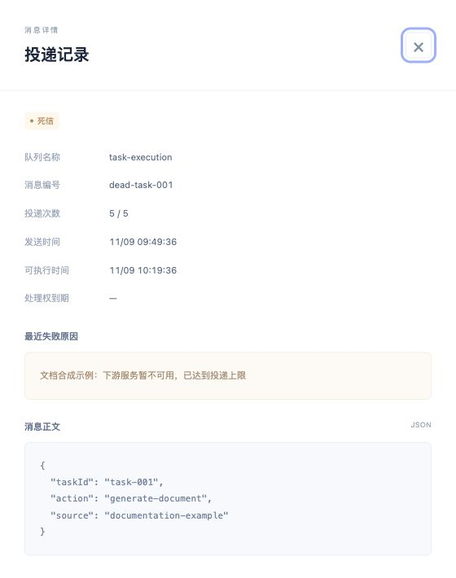
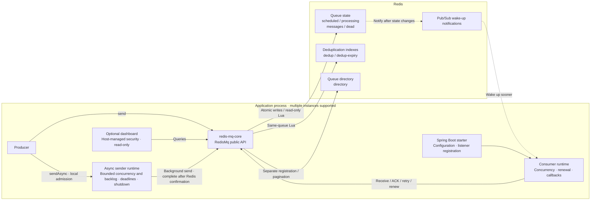
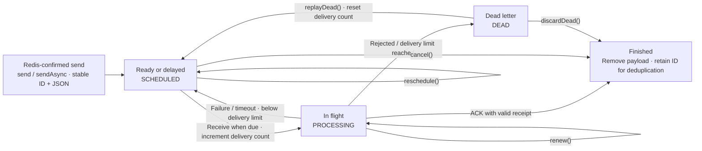

# Redis MQ

[简体中文](README.md) | **English**

A Redis-backed task queue for Java, with synchronous and bounded asynchronous sends, delayed delivery, competing consumers, acknowledgments, visibility timeouts, retries, and an optional read-only dashboard.

## Maven dependencies

Requires **Java 17+ and Redis 6.2+**. Choose one dependency from Maven Central and add it to your `pom.xml`; no additional repository is required.

| Use case | artifactId | Includes |
|---|---|---|
| Spring Boot messaging | `redis-mq-spring-boot-starter` | core |
| Messaging + live read-only dashboard | `redis-mq-dashboard` | starter, core |
| Messaging + dashboard + MySQL history | `redis-mq-dashboard-mysql` | dashboard, starter, core |
| Plain Java application | `redis-mq-core` | Core API and consumer runtime |

### Spring Boot

```xml
<dependency>
    <groupId>io.github.linbin-mk</groupId>
    <artifactId>redis-mq-spring-boot-starter</artifactId>
    <version>0.4.0</version>
</dependency>
```

Supply a `RedissonClient` bean to get an auto-configured `RedisMq`. Consumer threads start only when listeners are registered. The component reuses the client without changing its settings or owning its lifecycle.

### Add the live dashboard

```xml
<dependency>
    <groupId>io.github.linbin-mk</groupId>
    <artifactId>redis-mq-dashboard</artifactId>
    <version>0.4.0</version>
</dependency>
```

The dashboard is disabled by default. [Enable it](#embedded-dashboard) and visit `/redis-mq/dashboard/`. This dependency does not bring in MySQL.

### Add MySQL history

```xml
<dependency>
    <groupId>io.github.linbin-mk</groupId>
    <artifactId>redis-mq-dashboard-mysql</artifactId>
    <version>0.4.0</version>
</dependency>
```

Persist queue trends, per-minute metrics and P95 latency with a default five-day retention window. Explicitly initialize the analytics tables and enable persistence; see the [MySQL configuration and schema guide](docs/MySQL历史分析.md). An isolated small pool leaves your business data source unchanged. Analytics degrade during database failures while MQ operations continue; the statistics buffer is bounded.

### Plain Java

```xml
<dependency>
    <groupId>io.github.linbin-mk</groupId>
    <artifactId>redis-mq-core</artifactId>
    <version>0.4.0</version>
</dependency>
```

Supply and manage your own `RedissonClient`. The core requires no database, configuration service or separate message broker process.

## Monitoring features

These focused screenshots show the component's own UI with **synthetic example data**, without connecting to a business system. Values are not performance measurements. The dashboard only reads data; queries do not recover, replay or delete messages. UI labels are currently in Chinese.

### Live state and backlog

See ready, delayed, processing and dead-letter counts, backlog trends for the current page, and expired-lease or dead-letter notices. Live trends begin sampling when the page opens.



### MySQL history and per-minute metrics

Select a queue and a one-hour, 24-hour, five-day or custom range. Switch between backlog, processing rates and P95. Persisted data survives page reloads; missing windows remain gaps. Retention is configurable, with automatic bounded cleanup.



### Delivery details and failure reasons

Browse existing messages by state and load delivery counts, failure reasons and JSON payloads on demand. MySQL analytics do not archive individual completed messages or business payloads.



## What's new in 0.4.0 and upgrading

Adds [`sendAsync`](#asynchronous-sends) with a separate worker pool, shared per-instance concurrency and backlog limits, immediate local rejection, send deadlines, cancellation and bounded shutdown. Configure `redis-mq.producer.*`; defaults are 4 concurrent sends, 256 waiting tasks, a 5-second send timeout and a 30-second shutdown budget. `asyncSendStats()` exposes independent local sender statistics. Producer-only Spring applications also get automatic lifecycle management.

**A normal async return means accepted locally; successful Future completion means Redis confirmed insertion or deduplication. A timeout or connection failure may still have inserted the message.** Applications send after the business transaction commits and own failure logging, business metrics and retry or reconciliation policies.

Upgrading from `0.3.x` requires no Redis data or MySQL history schema migration; storage format remains 2. Existing synchronous `send` and constructors remain compatible. Plain Java applications using async sends must call `mq.close()` before shutting down their Redis client.

Since `0.3.1`, built-in dashboard authentication and the Spring Security dependency have been removed. The host application owns security. When upgrading from `0.3.0`, remove `redis-mq.dashboard.username/password` and configure host access controls for `/redis-mq/dashboard` and all its subpaths.

Adds optional MySQL history, bounded per-minute aggregation, idempotent multi-instance counters, P95 histograms, collector leases, query scan limits and a default rolling five-day retention window. Metric events accumulate in memory without adding Redis monitoring logs.

Upgrading from `0.2.0` keeps storage format 2 and requires no additional migration. MySQL remains optional. **Upgrading from `0.1.0` requires pausing writes and migrating, or draining with the old client first. Do not mix format 1 clients with the new format.**

[Changelog](CHANGELOG.md) · [Capacity and upgrades](docs/容量保护与升级.md) · [Docker and browser validation](docs/review-20261109/验收报告.md)

## Architecture and message lifecycle

### Component architecture



State and deduplication indexes for one queue share a hash tag and are updated atomically with Lua. Directory registration is separate from message delivery. Pub/Sub accelerates wake-ups; bounded polling still checks when messages become eligible.

### Message lifecycle



Expired leases are recovered by later consumer receive operations, not by dashboard queries. Old receipts cannot acknowledge a new delivery. Consumer callbacks must still handle duplicate execution through idempotency.

## Requirements

Requires Java 17+, Maven, and Redis 6.2+. The Spring Boot modules use Spring Boot 3.5.16 and Redisson 3.52.0.

## Build from source

For local development or source changes, build and install the artifacts into your local Maven repository:

```bash
mvn clean install
```

Maintainer instructions for publishing to Maven Central are in the [publishing guide](docs/发布说明.md), currently in Chinese.

## Send messages

Payloads use JSON without storing Java class names or enabling polymorphic type resolution. Serialization is independent of the Redis client's default object codec.

```java
import com.mk.mq.RedisMq;
import com.mk.mq.SendOptions;
import com.mk.mq.SendResult;
import java.time.Duration;

public record TaskRequest(String taskId) { }

// Create options once per send request and retain the stable message ID.
SendOptions options = SendOptions.delayed(Duration.ofSeconds(30));
SendResult result = mq.send("task-execution", new TaskRequest("task-001"), options);
```

The delay starts when Redis executes the send script. A successfully handled and acknowledged message finishes; it does not become a recurring task.

A send timeout does not mean that the message was not enqueued. Retry with the original payload and `SendOptions`. Create new options for a separate task. Use `withMessageId()` for a stable request ID and `withDeduplication(key, window)` for an additional deduplication window. Reusing an ID or an active deduplication key with different JSON content is rejected.

Message IDs remain deduplicated while their payload exists and, by default, for another 24 hours after completion or cancellation. Fingerprints use serialized bytes, so retries must produce the same serialized content.

### Asynchronous sends

`sendAsync` has the same immediate, delay and `SendOptions` overloads as `send`, returning `CompletableFuture<SendResult>`. A normal return means **accepted locally**; successful completion means Redis confirmed insertion or an existing deduplication record. This does not confirm consumption or add durability/replication guarantees.

```java
// Execute after the business transaction commits, e.g. an AFTER_COMMIT transaction event.
SendOptions request = SendOptions.immediate();
try {
    mq.sendAsync("task-execution", new TaskRequest("task-001"), request)
        .whenComplete((result, failure) -> {
            if (failure != null) {
                log.warn("Async send failed, messageId={}", request.messageId(), failure);
                // Record business metrics; let reconciliation repair permitted missed deliveries.
            }
        });
} catch (com.mk.mq.SendRejectedException rejected) {
    log.warn("Send not accepted, messageId={}, reason={}", request.messageId(), rejected.reason());
}
```

Validation and size-limited JSON serialization run on the caller, after reserving local capacity; neither queue registration nor insertion waits for Redis on that thread. Queued tasks retain a JSON snapshot rather than the mutable input object. Invalid arguments/serialization fail synchronously. `SendRejectedException` reports local `CAPACITY` or `CLOSED` rejection, with no Redis request for that submission. Redis-side capacity rejection completes the Future exceptionally instead. Limits are shared by all queues on one `RedisMq` instance; synchronous `send` remains independent. Concurrent sends do not guarantee insertion order.

The send deadline starts at local acceptance and covers waiting, queue registration and Redis calls, excluding caller-side serialization. `SendTimeoutException.outcomeUnknown()` is false for expired waiting tasks, which are removed and never sent; true means the underlying call started and may still insert the message. Connection failures may also leave the outcome unknown. Retry with the original payload and `SendOptions` if the application chooses to retry. The component adds no automatic send retries; Redisson connection/command timeouts and retries remain configured by the host.

Timeout or cancellation does not release capacity held by a running Redis call until it returns. Cancellation removes waiting tasks but does not retract started writes. Results complete on a separate bounded notification pool; keep callbacks lightweight and use your own bounded executor for blocking work. Synchronous callbacks registered after completion, and cancellation callbacks, may run on the caller according to normal `CompletableFuture` rules. Slow callbacks retain admission capacity and may delay later notifications. Cancelled deadline tasks are promptly removed.

`mq.asyncSendStats()` returns local counters (accepted, succeeded, duplicates, failed, rejected, timed out, cancelled), preparation/waiting/running/outstanding gauges and elapsed-time totals without I/O. Success includes duplicates; failures exclude timeout and cancellation. These metrics are independent of Redis queue state and the existing MySQL history schema. Applications can export the snapshot to their monitoring system.

Plain Java callers must call `mq.close()` before shutting down the external Redis client. It stops admission and waits up to `producer.shutdown-timeout`; remaining waiting tasks fail with `SendShutdownException(false)`, running tasks with `SendShutdownException(true)` (unknown outcome), and workers are interrupted on a best-effort basis. Notifications remain asynchronous and blocking callbacks can delay them. Closing does not retract writes, close the host Redis client or consumer handles, or disable synchronous operations. Spring stops annotation consumers before draining the producer, including producer-only mode. The host Redis lifecycle must stop later (producer phase: `Integer.MAX_VALUE - 200`).

Configure plain Java via `new RedisMq(redis, namespace, mqOptions, mapper, producerOptions)` using `ProducerOptions.defaults()` or custom values. Threads start on demand; synchronous-only usage starts no async threads.

## Consume messages

A Spring listener must execute synchronously and return `void`. Its first parameter is the payload; an optional second parameter is `MessageContext`. Normal completion triggers acknowledgment. Ordinary exceptions trigger backoff retries; `RejectMessageException` moves the message directly to dead letters.

```java
import com.mk.mq.MessageContext;
import com.mk.mq.spring.RedisMqListener;
import org.springframework.stereotype.Component;

@Component
public class TaskListener {
    @RedisMqListener(queue = "task-execution", concurrency = 2)
    public void onMessage(TaskRequest request, MessageContext context) {
        // Finish processing before returning. External side effects must be idempotent.
        taskService.execute(request.taskId());
    }
}
```

Do not return immediately after handing work to an asynchronous task: returning marks consumption as successful. Only initialized singleton listeners are discovered; lazy or prototype beans are not instantiated for discovery.

Plain Java applications can depend on `redis-mq-core` alone:

```java
import com.mk.mq.ConsumerOptions;
import com.mk.mq.MqConsumer;
import com.mk.mq.RedisMq;

RedisMq mq = new RedisMq(existingClient, "example:dev");
MqConsumer<TaskRequest> consumer = mq.consume("task-execution", TaskRequest.class,
        (request, context) -> taskService.execute(request.taskId()), ConsumerOptions.defaults());

// Close the consumer on shutdown. The application owns existingClient.
consumer.close();
```

The low-level `receive()` API returns a `Delivery` with a receipt for that delivery attempt. Callers manage `acknowledge()`, `retry()`, `reject()`, and `renew()` themselves. A `false` result means that the current lease is no longer valid.

## Configuration

Configuration uses the `redis-mq` prefix and comes from application properties, environment variables, or a configuration service. The component contains no application connection settings. Options are read at startup; restart consumers after changing them. Instances sharing a queue should use consistent settings.

| Property | Default | Description |
|---|---|---|
| enabled | true | Enable MQ auto-configuration |
| listeners-enabled | true | Discover annotated consumers; false enables producer-only mode |
| namespace | Application name:active profiles | Isolates messages and directory entries; changing it selects a new namespace |
| max-queue-size | 100000 | Payload capacity per queue, including scheduled, in-flight, and dead-letter messages |
| max-message-bytes | 65536 | Maximum UTF-8 size of a JSON payload; hard maximum 64 KiB |
| max-queue-bytes | 67108864 | Total payload bytes per queue, including processing and dead letters; excludes Redis structure overhead |
| max-dedup-entries | 200000 | Idempotency entries per queue, including IDs, business keys and request aliases |
| max-registered-queues | 1024 | Queue directory limit per namespace |
| idempotency-retention | 24h | ID retention after completion or cancellation |
| concurrency | 4 | Concurrency per listener; overridable by the annotation |
| visibility | 60s | Delivery lease duration; renewed automatically by the runtime |
| max-processing-time | 5m | Stop renewal and request interruption after this processing limit |
| poll-interval | 500ms | Fallback check interval after missed notifications or reconnection |
| shutdown-timeout | 30s | Time to wait for callbacks when shutting down each listener |
| producer.concurrency | 4 | Shared async send concurrency per instance, 1–256 |
| producer.max-pending | 256 | Waiting task capacity, 1–100000; preparation and result delivery also count toward total capacity (concurrency + pending limit) |
| producer.send-timeout | 5s | Deadline after acceptance including waiting and registration; running calls retain capacity until the underlying call returns |
| producer.shutdown-timeout | 30s | Total async sender shutdown budget; zero is allowed |

By default, messages allow five deliveries. The first failure waits five seconds, with exponential backoff capped at five minutes. Configure this with `SendOptions.withRetry()`. Each receive counts as a delivery, including deliveries that time out without acknowledgment.

## Queries and management

- `get()` retrieves an existing message; completion, cancellation, or dead-letter deletion removes its payload.
- `stats()` returns ready, delayed, in-flight, expired-lease, dead-letter, and total payload counts.
- `cancel()` and `reschedule()` affect only scheduled messages; they do not revoke work that has already started.
- `deadMessages()` lists dead letters. `replayDead()` resets the delivery count and requeues; `discardDead()` removes the payload.
- `messages()` lists metadata by state, without payloads or receipts.
- `registerQueue()` registers a queue without sending messages or starting a consumer.
- `storageKeys()` returns the fixed keys for a known queue, supporting targeted operations without scanning Redis.

Dead letters remain until explicitly handled and count toward payload capacity. Expired deduplication indexes are cleaned lazily in bounded batches; idle queues do not run a separate cleanup process.

## Embedded dashboard

Web applications can depend on `io.github.linbin-mk:redis-mq-dashboard:0.4.0` to include core, starter, and dashboard together. The dashboard is disabled by default. Enable it with external configuration:

```yaml
redis-mq:
  namespace: example:dev
  dashboard:
    enabled: true
    queues:
      - task-execution
```

Open `/redis-mq/dashboard/` in the browser. The component does not depend on Spring Security or provide built-in accounts, passwords, or authentication filters. The host application owns authentication, authorization, HTTPS, and security headers. Include `/redis-mq/dashboard` and all its subpaths, including page resources and APIs, in the host application's access controls.

The page provides queue counts, expired-lease indicators, paginated messages, dead-letter errors, and on-demand payload inspection. The basic chart samples in browser memory. The optional MySQL extension adds persistent history, per-minute processing metrics and latency analysis that remain available after a page refresh. Totals cover successfully read queues on the current page, not a transactionally consistent snapshot across queues.

The dashboard exposes read operations only. It does not recover leases, replay, send, cancel, or delete messages. The component registers no security filter chain and leaves the host application's security policies unchanged.

All page assets ship in the component JAR. No external fonts, CDN, or frontend build is required.

## Implementation and guarantees

All message state resides in Redis, and Lua uses Redis server time for deadlines. Keys for a queue share a hash tag. Directory entries are registered separately and read without scanning Redis. The directory is for discovery, outside delivery atomicity; queues are registered on first send or consumer startup, and can also be pre-registered through configuration.

Delivery is at least once. Each receipt is checked against message state and lease expiration, so an old consumer cannot acknowledge or renew a newer delivery. A crash can still happen between completing an external side effect and acknowledging the message. Callbacks must be idempotent; enqueue deduplication does not replace processing idempotency.

Java interruption cannot forcibly terminate code that ignores it. Applications must also set external call timeouts. Actual delivery delay depends on polling, network latency, backlog, and execution capacity. Hard real-time delivery, strict global FIFO, broadcasting, multiple consumer groups, and atomic transactions with external stores are not provided.

A successful write means Redis accepted it; this version does not add `WAIT` / `WAITAOF` synchronization barriers. Durability depends on Redis persistence, replication, and failover settings. Cache eviction must not remove queue state. Atomic Lua execution does not imply rollback after a runtime error.

New writes use message format version 2; reads remain compatible with version 1. Follow the [upgrade guide](docs/容量保护与升级.md) before upgrading existing queues. Redis Cluster keys are designed for single-slot queue operations; automatic sharding of a queue is not provided. Validate Cluster, failover, and recovery behavior in the target deployment separately.

## Tests and contributions

Run `mvn clean verify` for the included tests; no Redis connection is required. See [testing notes](docs/测试说明.md) and [contribution guidelines](CONTRIBUTING.md), currently in Chinese.

## License

Original project code is licensed under [MIT](LICENSE), copyright linbin-mk. Maven metadata and component JARs include license information. Third-party dependencies retain their own licenses; see [NOTICE](NOTICE).

## Storage and bounded operations

New messages use storage format 2: payloads are stored separately from metadata. Reads support format 1, but old and new clients must not run concurrently. Pause producers, consumers, and administrative writes before upgrading existing data; migrate all three states with `migrateStorage(queue, state, offset, 10)`, advancing offset by the returned count until zero. Repeat safely if interrupted. Existing inline messages block new sends with `MQ_STORAGE_UPGRADE_REQUIRED` until migrated or drained. Do not downgrade clients after migration. The Chinese [upgrade guide](docs/容量保护与升级.md) includes an executable Java example and capacity sizing notes.

`receive()` accepts an upper bound, returning at most 16 deliveries and 64 KiB of payload per call. A short batch does not indicate an empty queue. Full `deadMessages()` pages also have a 64 KiB payload budget; advance offset by the actual returned count. Metadata pages keep their normal pagination. Expired leases are recovered at most eight per call; expired deduplication entries are cleaned at most 32 per call. `stats()` additionally reports `payloadBytes` and `dedupEntries`.

Queue names cannot contain colons; namespace and message IDs may still contain them. Payload serialization is bounded to 64 KiB, and canceled heartbeat/deadline tasks are immediately removed. Scripts use EVALSHA with NOSCRIPT recovery. Configure Redis `maxmemory` with `noeviction`; never set TTLs on queue keys. Budget separately for metadata, indexes, Redis overhead and other applications. Full queues reject new sends without evicting existing idempotency records; producers must back off. Capacity limits do not establish an absolute latency guarantee on arbitrary hardware or under unrelated Redis load.
