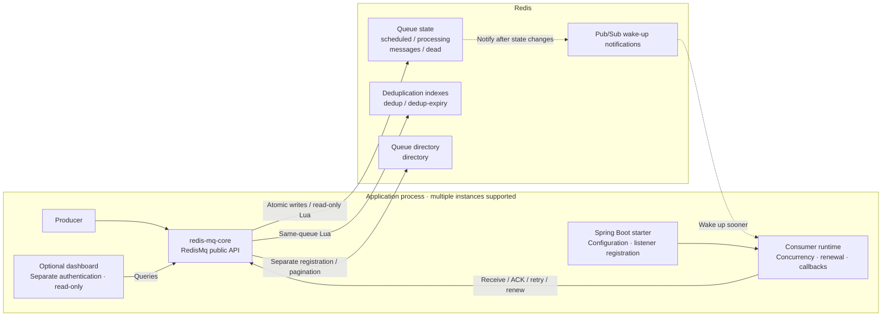
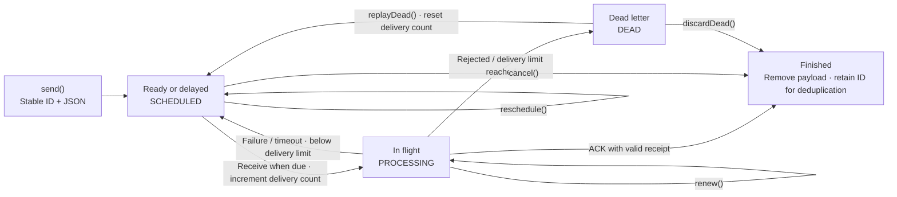
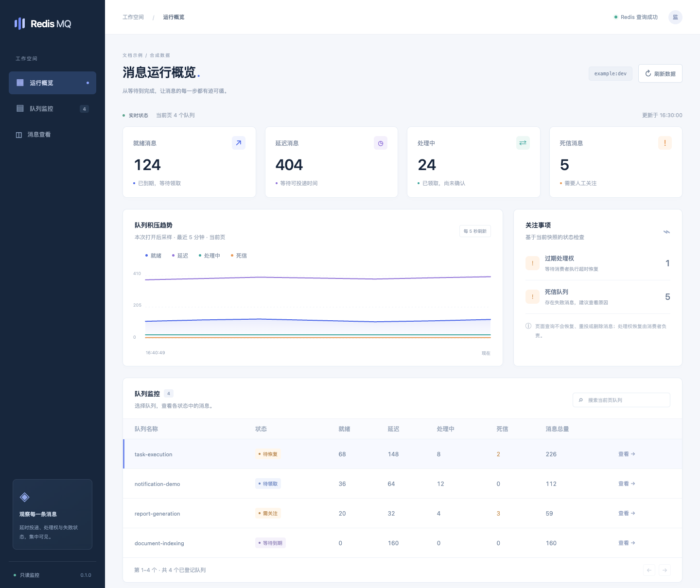
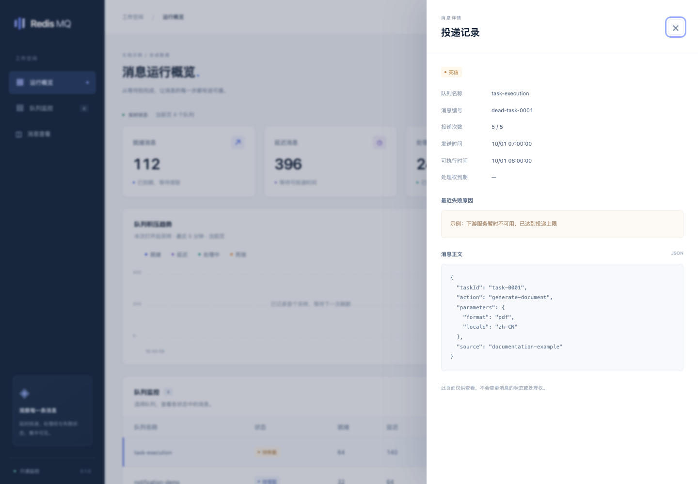

# Redis MQ

[简体中文](README.md) | **English**

A Redis-backed task queue for Java, with delayed delivery, competing consumers, acknowledgments, visibility timeouts, retries, and an optional read-only dashboard.

- Version: `0.1.0`
- Java package: `com.mk.mq`
- Maven groupId: `io.github.linbin-mk`
- License: [MIT](LICENSE)
- Main branch: `master`

## Modules

| Module | Purpose |
|---|---|
| redis-mq-core | Message state machine, Lua scripts, and consumer runtime; usable in plain Java applications |
| redis-mq-spring-boot-starter | Spring Boot auto-configuration and annotated listeners |
| redis-mq-dashboard | Optional embedded read-only dashboard; includes the starter and core |

The core requires no database, configuration service, or separate message broker process. The application supplies the Redis client and external configuration.

## Architecture and message lifecycle

### Component architecture



State and deduplication indexes for one queue share a hash tag and are updated atomically with Lua. Directory registration is separate from message delivery. Pub/Sub accelerates wake-ups; bounded polling still checks when messages become eligible.

### Message lifecycle



Expired leases are recovered by later consumer receive operations, not by dashboard queries. Old receipts cannot acknowledge a new delivery. Consumer callbacks must still handle duplicate execution through idempotency.

## Requirements and build

Requires Java 17+, Maven, and Redis 6.2+. The Spring Boot modules use Spring Boot 3.5.16 and Redisson 3.52.0.

```bash
mvn clean install
```

This builds and installs the artifacts into the local Maven repository. Other machines must build them or use a Maven repository where the artifacts have been published. Maintainer instructions for publishing to Maven Central are in the [publishing guide](docs/发布说明.md), currently in Chinese. Check Central for available releases before using a published dependency.

For a Spring Boot application:

```xml
<dependency>
    <groupId>io.github.linbin-mk</groupId>
    <artifactId>redis-mq-spring-boot-starter</artifactId>
    <version>0.1.0</version>
</dependency>
```

The application must provide a `RedissonClient` bean. The component reuses this client without changing its connection settings or taking ownership of its lifecycle. Auto-configuration supplies a `RedisMq` bean; consumer threads start only when listeners are registered.

## Send messages

Payloads use JSON without storing Java class names or enabling polymorphic type resolution. Serialization is independent of the Redis client's default object codec.

```java
import com.mk.mq.RedisMq;
import com.mk.mq.SendOptions;
import com.mk.mq.SendResult;
import java.time.Duration;

public record TaskRequest(String taskId) { }

// Create options once per send request and retain the stable message ID.
SendOptions options = SendOptions.delayed(Duration.ofSeconds(30));
SendResult result = mq.send("task-execution", new TaskRequest("task-001"), options);
```

The delay starts when Redis executes the send script. A successfully handled and acknowledged message finishes; it does not become a recurring task.

A send timeout does not mean that the message was not enqueued. Retry with the original payload and `SendOptions`. Create new options for a separate task. Use `withMessageId()` for a stable request ID and `withDeduplication(key, window)` for an additional deduplication window. Reusing an ID or an active deduplication key with different JSON content is rejected.

Message IDs remain deduplicated while their payload exists and, by default, for another 24 hours after completion or cancellation. Fingerprints use serialized bytes, so retries must produce the same serialized content.

## Consume messages

A Spring listener must execute synchronously and return `void`. Its first parameter is the payload; an optional second parameter is `MessageContext`. Normal completion triggers acknowledgment. Ordinary exceptions trigger backoff retries; `RejectMessageException` moves the message directly to dead letters.

```java
import com.mk.mq.MessageContext;
import com.mk.mq.spring.RedisMqListener;
import org.springframework.stereotype.Component;

@Component
public class TaskListener {
    @RedisMqListener(queue = "task-execution", concurrency = 2)
    public void onMessage(TaskRequest request, MessageContext context) {
        // Finish processing before returning. External side effects must be idempotent.
        taskService.execute(request.taskId());
    }
}
```

Do not return immediately after handing work to an asynchronous task: returning marks consumption as successful. Only initialized singleton listeners are discovered; lazy or prototype beans are not instantiated for discovery.

Plain Java applications can depend on `redis-mq-core` alone:

```java
import com.mk.mq.ConsumerOptions;
import com.mk.mq.MqConsumer;
import com.mk.mq.RedisMq;

RedisMq mq = new RedisMq(existingClient, "example:dev");
MqConsumer<TaskRequest> consumer = mq.consume("task-execution", TaskRequest.class,
        (request, context) -> taskService.execute(request.taskId()), ConsumerOptions.defaults());

// Close the consumer on shutdown. The application owns existingClient.
consumer.close();
```

The low-level `receive()` API returns a `Delivery` with a receipt for that delivery attempt. Callers manage `acknowledge()`, `retry()`, `reject()`, and `renew()` themselves. A `false` result means that the current lease is no longer valid.

## Configuration

Configuration uses the `redis-mq` prefix and comes from application properties, environment variables, or a configuration service. The component contains no application connection settings. Options are read at startup; restart consumers after changing them. Instances sharing a queue should use consistent settings.

| Property | Default | Description |
|---|---|---|
| enabled | true | Enable MQ auto-configuration |
| listeners-enabled | true | Discover annotated consumers; false enables producer-only mode |
| namespace | Application name:active profiles | Isolates messages and directory entries; changing it selects a new namespace |
| max-queue-size | 100000 | Payload capacity per queue, including scheduled, in-flight, and dead-letter messages |
| max-message-bytes | 65536 | Maximum UTF-8 size of a JSON payload |
| idempotency-retention | 24h | ID retention after completion or cancellation |
| concurrency | 4 | Concurrency per listener; overridable by the annotation |
| visibility | 60s | Delivery lease duration; renewed automatically by the runtime |
| max-processing-time | 5m | Stop renewal and request interruption after this processing limit |
| poll-interval | 500ms | Fallback check interval after missed notifications or reconnection |
| shutdown-timeout | 30s | Time to wait for callbacks when shutting down each listener |

By default, messages allow five deliveries. The first failure waits five seconds, with exponential backoff capped at five minutes. Configure this with `SendOptions.withRetry()`. Each receive counts as a delivery, including deliveries that time out without acknowledgment.

## Queries and management

- `get()` retrieves an existing message; completion, cancellation, or dead-letter deletion removes its payload.
- `stats()` returns ready, delayed, in-flight, expired-lease, dead-letter, and total payload counts.
- `cancel()` and `reschedule()` affect only scheduled messages; they do not revoke work that has already started.
- `deadMessages()` lists dead letters. `replayDead()` resets the delivery count and requeues; `discardDead()` removes the payload.
- `messages()` lists metadata by state, without payloads or receipts.
- `registerQueue()` registers a queue without sending messages or starting a consumer.
- `storageKeys()` returns the fixed keys for a known queue, supporting targeted operations without scanning Redis.

Dead letters remain until explicitly handled and count toward payload capacity. Expired deduplication indexes are cleaned lazily in bounded batches; idle queues do not run a separate cleanup process.

## Embedded dashboard

Web applications can depend on `io.github.linbin-mk:redis-mq-dashboard:0.1.0` to include core, starter, and dashboard together. The dashboard is disabled by default. Enable it with external configuration:

```yaml
redis-mq:
  namespace: example:dev
  dashboard:
    enabled: true
    username: monitor
    password: ${REDIS_MQ_DASHBOARD_PASSWORD}
    queues:
      - task-execution
```

The password comes from the runtime environment; there is no default password. Enabling the dashboard requires a separate administrator password of at least sixteen characters. Open `/redis-mq/dashboard/` through the application's HTTPS endpoint and sign in with HTTP Basic authentication.

The page provides queue counts, expired-lease indicators, paginated messages, dead-letter errors, and on-demand payload inspection. Trends start sampling when the page is opened; historical metrics are not persisted. Totals cover successfully read queues on the current page, not a transactionally consistent snapshot across queues.

The dashboard exposes read operations only. It does not recover leases, replay, send, cancel, or delete messages. The application retains control over authentication for other paths. The separate dashboard security chain has order `-100` and matches only dashboard paths; adjust the application's filter ordering if a higher-priority chain matches all paths.

All page assets ship in the component JAR. No external fonts, CDN, or frontend build is required.

### Dashboard preview

These images render the bundled dashboard with **synthetic example data**, without connecting to Redis or an application system. The values illustrate the UI and are not benchmark results. The dashboard UI shown here is in Chinese.

**Overview: queue counts, backlog trends, expired leases, and the queue directory.**



**Message details: delivery count, timestamps, failure reason, and on-demand JSON payload.**



## Implementation and guarantees

All message state resides in Redis, and Lua uses Redis server time for deadlines. Keys for a queue share a hash tag. Directory entries are registered separately and read without scanning Redis. The directory is for discovery, outside delivery atomicity; queues are registered on first send or consumer startup, and can also be pre-registered through configuration.

Delivery is at least once. Each receipt is checked against message state and lease expiration, so an old consumer cannot acknowledge or renew a newer delivery. A crash can still happen between completing an external side effect and acknowledging the message. Callbacks must be idempotent; enqueue deduplication does not replace processing idempotency.

Java interruption cannot forcibly terminate code that ignores it. Applications must also set external call timeouts. Actual delivery delay depends on polling, network latency, backlog, and execution capacity. Hard real-time delivery, strict global FIFO, broadcasting, multiple consumer groups, and atomic transactions with external stores are not provided.

A successful write means Redis accepted it; this version does not add `WAIT` / `WAITAOF` synchronization barriers. Durability depends on Redis persistence, replication, and failover settings. Cache eviction must not remove queue state. Atomic Lua execution does not imply rollback after a runtime error.

The message format version is 1. Redis Cluster keys are designed for single-slot queue operations; automatic sharding of a queue is not provided. Validate Cluster, failover, and recovery behavior in the target deployment separately.

## Tests and contributions

Run `mvn clean verify` for the included tests; no Redis connection is required. See [testing notes](docs/测试说明.md) and [contribution guidelines](CONTRIBUTING.md), currently in Chinese.

## License

Original project code is licensed under [MIT](LICENSE), copyright linbin-mk. Maven metadata and component JARs include license information. Third-party dependencies retain their own licenses; see [NOTICE](NOTICE).
