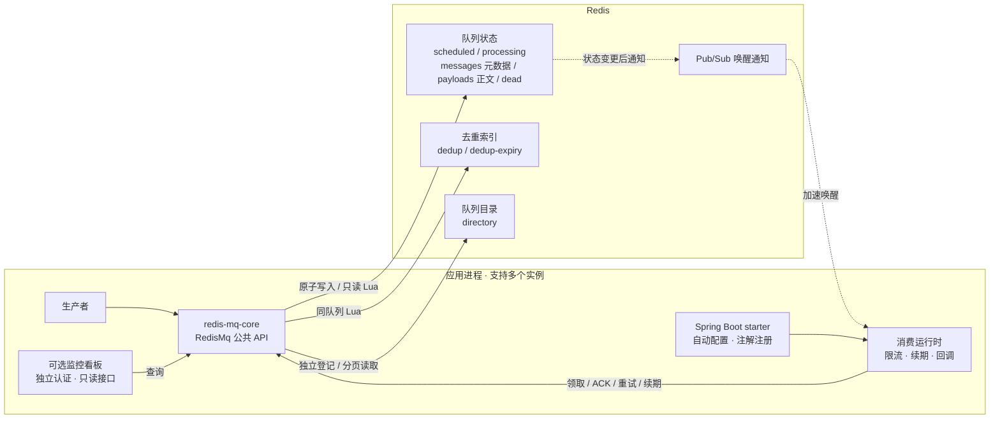
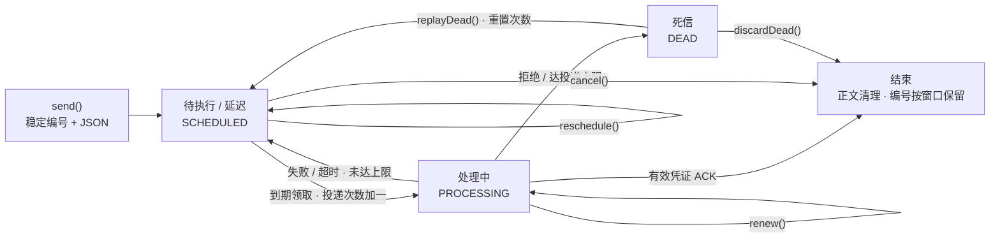
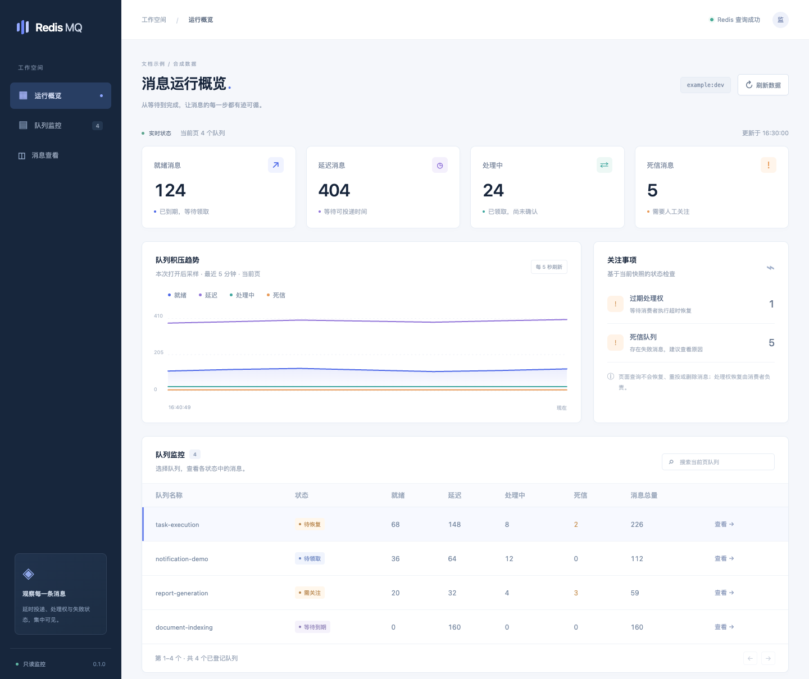
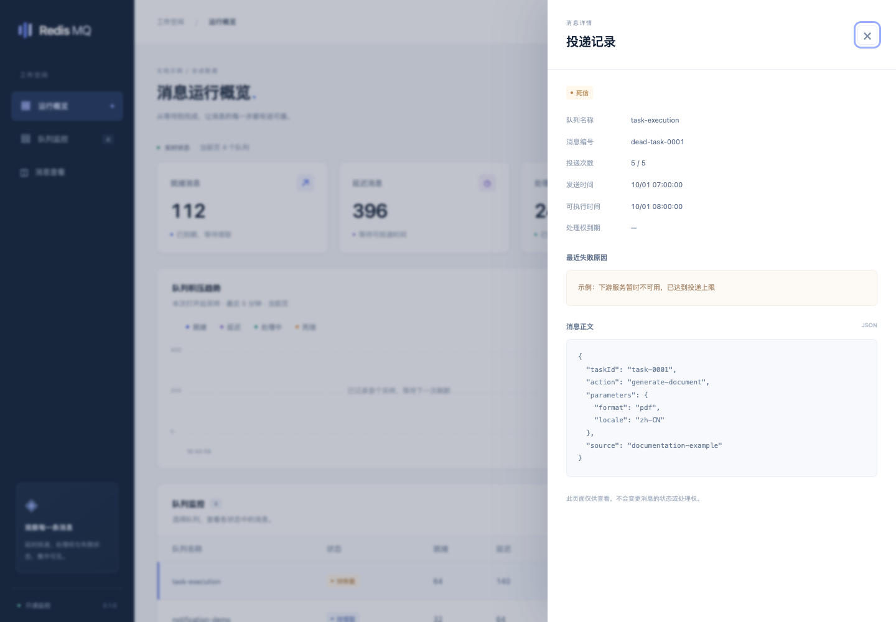

# Redis MQ

**简体中文** | [English](README.en.md)

基于 Redis 的 Java 可靠任务队列，提供延时投递、竞争消费、成功确认、超时恢复、失败重试和只读监控看板。

- 版本：`0.2.0`
- Java 基础包：`com.mk.mq`
- Maven groupId：`io.github.linbin-mk`
- 开源协议：[MIT](LICENSE)
- 主分支：`master`

## 0.2.0 更新

- 正文与元数据分离，大消息领取、续期和确认减少 JSON 编解码；领取上限为 16 条、正文合计 64 KiB。
- 新增正文总字节数、防重索引和队列目录容量保护，修复发送绕过 Redis OOM 检查的问题。
- 消费者取消的定时任务立即清理，最长处理时间由独立线程计时；脚本使用 SHA 缓存并自动恢复。
- Redis 6.2 / 7.4 的真实集成、并发和 OOM 测试纳入发布前检查。

**从 0.1.0 升级：存储格式变为版本 2，新旧客户端不能混跑。先停止生产、消费和管理写入，迁移存量数据或用旧版排空后再切换；队列名不再允许冒号，单条 JSON 正文最多 64 KiB。**

阅读[更新记录](CHANGELOG.md)、[容量配置与升级步骤](docs/容量保护与升级.md)和[本机验收结果](docs/review-20261108/验收报告.md)。

## 模块

| 模块 | 用途 |
|---|---|
| redis-mq-core | 消息状态机、Lua 脚本、消费运行时；可用于普通 Java 应用 |
| redis-mq-spring-boot-starter | Spring Boot 自动配置与注解监听器 |
| redis-mq-dashboard | 可选的应用内嵌只读监控看板，包含 starter 与 core |

核心模块不依赖数据库、配置中心或独立消息代理进程。应用负责提供 Redis 客户端和外部配置。

## 架构与消息流转

### 组件架构



同一队列的状态和去重索引共享哈希标签，通过 Lua 原子更新；目录独立登记，不参与消息投递事务。Pub/Sub 只加速唤醒，消费者仍通过有界轮询检查到期消息。

### 消息生命周期



处理权超时由消费者后续领取时恢复，监控查询不会触发恢复。旧凭证不能确认新领取；重复执行仍需由消费回调通过幂等处理。

## 环境要求

要求 Java 17 及以上、Maven、Redis 6.2 及以上。Spring Boot 模块基于 3.5.16，Redis 客户端基于 Redisson 3.52.0。

## Maven 引用

以下示例使用 `0.2.0`，通过默认 Maven Central 仓库引用，在项目 `pom.xml` 的 `<dependencies>` 中按需添加以下一个组件。

### Spring Boot 应用

```xml
<dependency>
    <groupId>io.github.linbin-mk</groupId>
    <artifactId>redis-mq-spring-boot-starter</artifactId>
    <version>0.2.0</version>
</dependency>
```

starter 已包含核心模块。Spring Boot 应用须提供一个 `RedissonClient` Bean；组件复用该客户端，不修改其连接配置，不创建或关闭应用持有的客户端。引入依赖后自动提供 `RedisMq` Bean；声明监听器后才启动消费线程。

### Spring Boot 应用与监控看板

需要内嵌监控看板时，使用以下依赖，它已包含 starter 与核心模块：

```xml
<dependency>
    <groupId>io.github.linbin-mk</groupId>
    <artifactId>redis-mq-dashboard</artifactId>
    <version>0.2.0</version>
</dependency>
```

应用同样须提供 `RedissonClient` Bean。看板默认关闭，启用方式见[内嵌监控看板](#内嵌监控看板)。

### 普通 Java 应用

普通 Java 应用可单独引用核心模块，由应用提供并管理 `RedissonClient`：

```xml
<dependency>
    <groupId>io.github.linbin-mk</groupId>
    <artifactId>redis-mq-core</artifactId>
    <version>0.2.0</version>
</dependency>
```

## 从源码构建

本地开发或修改源码时，可构建并安装到本机 Maven 仓库：

```bash
mvn clean install
```

维护者发布到 Maven Central 的操作步骤见[发布说明](docs/发布说明.md)。

## 发送消息

消息体采用 JSON，不保存 Java 类名，不启用多态自动类型解析；编码与 Redis 客户端的默认对象 Codec 相互独立。

```java
import com.mk.mq.RedisMq;
import com.mk.mq.SendOptions;
import com.mk.mq.SendResult;
import java.time.Duration;

public record TaskRequest(String taskId) { }

// 为一次发送请求创建选项，保留其稳定消息编号。
SendOptions options = SendOptions.delayed(Duration.ofSeconds(30));
SendResult result = mq.send("task-execution", new TaskRequest("task-001"), options);
```

延迟从 Redis 执行发送脚本时起算。消息成功处理并确认后结束，不会自行周期性执行。

发送超时不代表消息未入队，应使用原消息体和原 `SendOptions` 重试。新的独立任务创建新的发送选项。可通过 `withMessageId()` 指定请求编号，通过 `withDeduplication(key, window)` 设置业务去重窗口。同一编号或窗口内同一去重键对应不同 JSON 内容时拒绝发送。

消息编号在正文存在期间保持防重；完成或取消后默认再保留 24 小时。去重指纹基于序列化后的字节，请求重试时应保持序列化结果一致。

## 消费消息

Spring 监听方法须同步执行并返回 `void`，第一个参数为消息体，第二个 `MessageContext` 参数可选。正常返回后自动确认，普通异常按退避规则重试，`RejectMessageException` 直接进入死信。

```java
import com.mk.mq.MessageContext;
import com.mk.mq.spring.RedisMqListener;
import org.springframework.stereotype.Component;

@Component
public class TaskListener {
    @RedisMqListener(queue = "task-execution", concurrency = 2)
    public void onMessage(TaskRequest request, MessageContext context) {
        // 在返回前完成任务处理；外部副作用需要支持重复调用。
        taskService.execute(request.taskId());
    }
}
```

不要在方法中提交异步任务后立即返回，否则方法返回时即被视为消费成功。仅自动发现已初始化的单例监听器，不为发现监听器而创建懒加载或多例对象。

普通 Java 应用可单独引用 `redis-mq-core`：

```java
import com.mk.mq.ConsumerOptions;
import com.mk.mq.MqConsumer;
import com.mk.mq.RedisMq;

RedisMq mq = new RedisMq(existingClient, "example:dev");
MqConsumer<TaskRequest> consumer = mq.consume("task-execution", TaskRequest.class,
        (request, context) -> taskService.execute(request.taskId()), ConsumerOptions.defaults());

// 应用退出时关闭消费者，由应用管理 existingClient 的生命周期。
consumer.close();
```

低层 `receive()` 的数量参数是上限，单次最多领取 16 条且正文合计不超过 64 KiB；返回少于请求数量不代表队列为空。接口返回带独立领取凭证的 `Delivery`，调用方自行负责 `acknowledge()`、`retry()`、`reject()` 和 `renew()`。这些所有权操作返回 `false` 时，当前处理权已失效。

## 配置

配置前缀为 `redis-mq`，由应用使用属性文件、环境变量或配置中心提供。组件不携带应用连接配置。配置在启动时读取，运行中调整后需重启消费者；同一队列的不同实例应采用一致配置。

| 参数 | 默认值 | 说明 |
|---|---|---|
| enabled | true | 是否创建 MQ 自动配置 |
| listeners-enabled | true | 是否自动注册注解消费者；false 表示仅发送 |
| namespace | 应用名:当前环境 | 消息和目录的隔离空间；变更后属于新空间 |
| max-queue-size | 100000 | 每队列正文容量，包含待执行、处理中和死信 |
| max-message-bytes | 65536 | JSON 消息体的 UTF-8 字节上限，最大支持 64 KiB |
| max-queue-bytes | 67108864 | 每队列正文合计上限（64 MiB），含处理中和死信，不含 Redis 结构开销 |
| max-dedup-entries | 200000 | 每队列防重索引上限，含消息编号、业务去重键及重复请求别名 |
| max-registered-queues | 1024 | 每个命名空间的队列目录上限 |
| idempotency-retention | 24h | 完成或取消后消息编号的保留时间 |
| concurrency | 4 | 每个监听器的并发数，可由注解覆盖 |
| visibility | 60s | 本次处理权期限，运行时自动续期 |
| max-processing-time | 5m | 最长执行时间，超过后停止续期并请求中断 |
| poll-interval | 500ms | 通知丢失或重连时的兜底检查间隔 |
| shutdown-timeout | 30s | 每个监听器停机时等待回调完成的时间 |

每条消息默认最多投递五次，首次失败延迟五秒，之后指数增长，最大五分钟。可通过 `SendOptions.withRetry()` 指定。领取即计一次投递，未确认的超时领取也消耗次数。

## 查询与管理

- `get()` 查询现存消息，成功确认、取消或死信删除后正文不存在。
- `stats()` 返回就绪、延迟、处理中、已过期处理权、死信、正文总数，以及 `payloadBytes` 正文字节数和 `dedupEntries` 防重索引数。
- `cancel()`、`reschedule()` 仅作用于待执行消息，不撤销已开始的任务。
- `deadMessages()` 分页查看死信，单次正文合计不超过 64 KiB，继续分页时按实际返回条数增加 offset；`replayDead()` 重置投递次数并重放，`discardDead()` 删除正文。
- `messages()` 按状态分页读取元数据，不包含正文和领取凭证。
- `registerQueue()` 预登记队列，不发送消息、不启动消费者。
- `storageKeys()` 返回已知队列的固定键名，用于精确运维，不扫描整个 Redis。

队列名支持字母、数字、点、下划线和横线，最长 160 字符；冒号仅允许用于命名空间和消息编号，避免跨命名空间的键名冲突。死信保留到显式处理，计入正文容量。过期去重索引每次最多清理 32 条，超时处理权每次最多恢复 8 条，闲置队列不会自行运行清理进程。容量满时拒绝新请求；生产者应退避或降载，不能无限立即重试。防重容量需结合吞吐量和保留窗口计算，详见[容量保护与升级](docs/容量保护与升级.md)。

## 内嵌监控看板

Web 应用将依赖改为 `io.github.linbin-mk:redis-mq-dashboard:0.2.0`，即可同时获得核心、starter 和看板。看板默认关闭，通过外部配置启用：

```yaml
redis-mq:
  namespace: example:dev
  dashboard:
    enabled: true
    username: monitor
    password: ${REDIS_MQ_DASHBOARD_PASSWORD}
    queues:
      - task-execution
```

口令从运行环境注入，不使用默认值。启用时至少需要十六位独立管理员口令。浏览器通过应用的 HTTPS 入口访问 `/redis-mq/dashboard/`，使用 HTTP Basic 登录。

页面提供队列统计、过期处理权提示、消息分页、死信原因及按需正文查看。趋势从本次打开页面后开始采样，不提供持久化历史指标。汇总只涵盖当前页成功读取的队列，跨队列统计不是事务快照。

看板只有读取接口，不触发处理权恢复、重投、发送、取消或删除。应用其他路径的认证仍由应用维护；看板独立认证链顺序为 `-100`，只匹配看板路径。若应用存在更高优先级且匹配所有路径的过滤链，需要自行调整匹配顺序。

页面资源随组件 JAR 提供，无外部字体、CDN 或前端构建要求。

### 看板预览

以下图片使用组件自带页面和**合成示例数据**渲染，不连接实际 Redis 或业务系统；数值仅用于展示界面，不代表性能测试结果。

**队列总览：统计、积压趋势、过期处理权提示与队列目录。**



**消息详情：投递次数、时间、失败原因与按需读取的 JSON 正文。**



## 实现与保证范围

所有消息状态保存在 Redis，期限在 Lua 内使用 Redis 服务端时间计算。固定键使用同一队列的哈希标签，队列目录单独登记，读取时不扫描 Redis。目录仅用于发现，不参与投递原子性；首次发送或启动消费者会登记队列，也可以通过配置预登记。

队列采用至少一次投递语义。每次领取的凭证同时受状态和期限约束，旧消费者无法确认或续期新领取。业务处理成功与消息确认之间仍可能出现宕机窗口，消费回调必须支持重复执行；发送去重不能替代业务幂等。

Java 中断不能强制结束忽略中断的任务，应用还需为外部调用设置超时。实际到期延迟受轮询间隔、网络、积压和执行容量影响，不保证硬实时、全局严格 FIFO、广播、多个消费组或跨业务存储的原子事务。

组件写入成功表示 Redis 接受了操作，未增加 `WAIT` / `WAITAOF` 强同步确认。消息持久性取决于 Redis 的持久化、复制和故障切换策略。Redis 应配置 `maxmemory` 和 `maxmemory-policy noeviction`，队列固定键不能设置 TTL 或被缓存淘汰；同实例还需为业务缓存、索引和 Redis 结构开销预留容量。Lua 的原子执行不等于运行错误下的事务回滚。

新写入消息格式版本为 2，兼容读取版本 1。升级方法见[容量保护与升级](docs/容量保护与升级.md)。Redis Cluster 的队列键按单槽设计，不提供单队列自动分片；Cluster、主从切换及故障恢复应在目标部署环境单独验证。

## 测试与贡献

执行 `mvn clean verify` 运行仓库自带测试，不要求连接 Redis。测试范围和集成验证建议见[测试说明](docs/测试说明.md)，贡献方式见[贡献指南](CONTRIBUTING.md)。

## 许可证

本项目自有代码采用 [MIT](LICENSE)，版权署名为 linbin-mk。Maven 元数据和组件 JAR 均携带许可证信息。第三方依赖保留各自的许可证，见 [NOTICE](NOTICE)。
